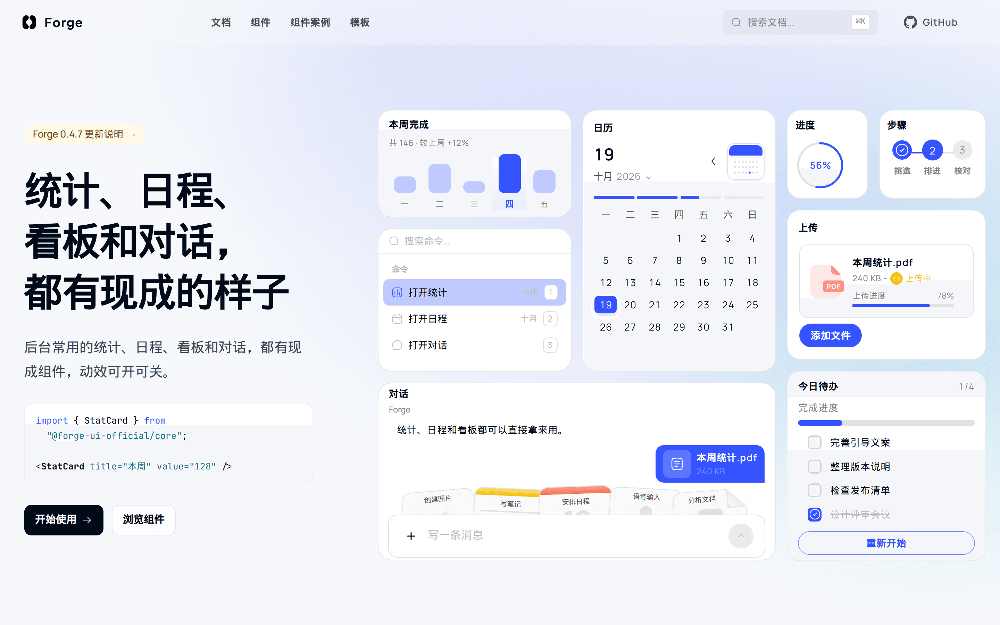
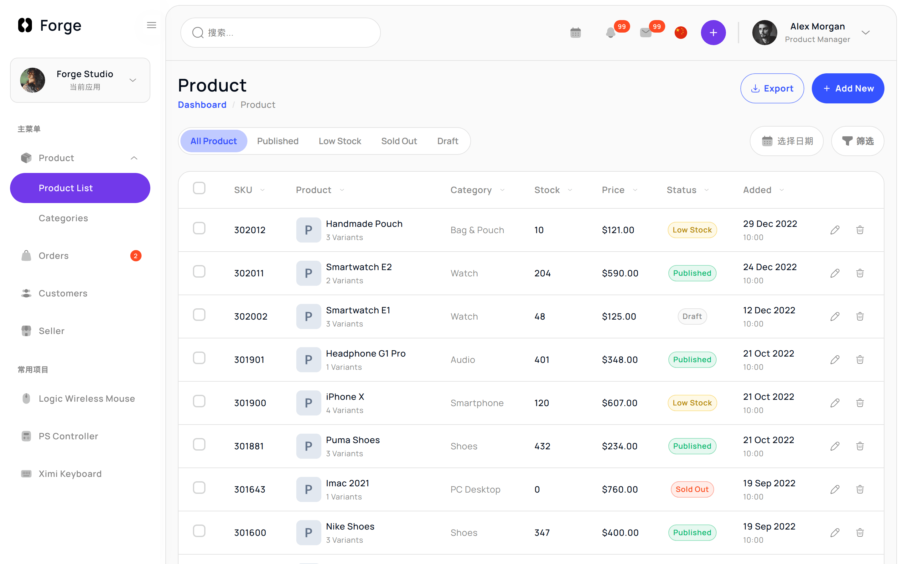
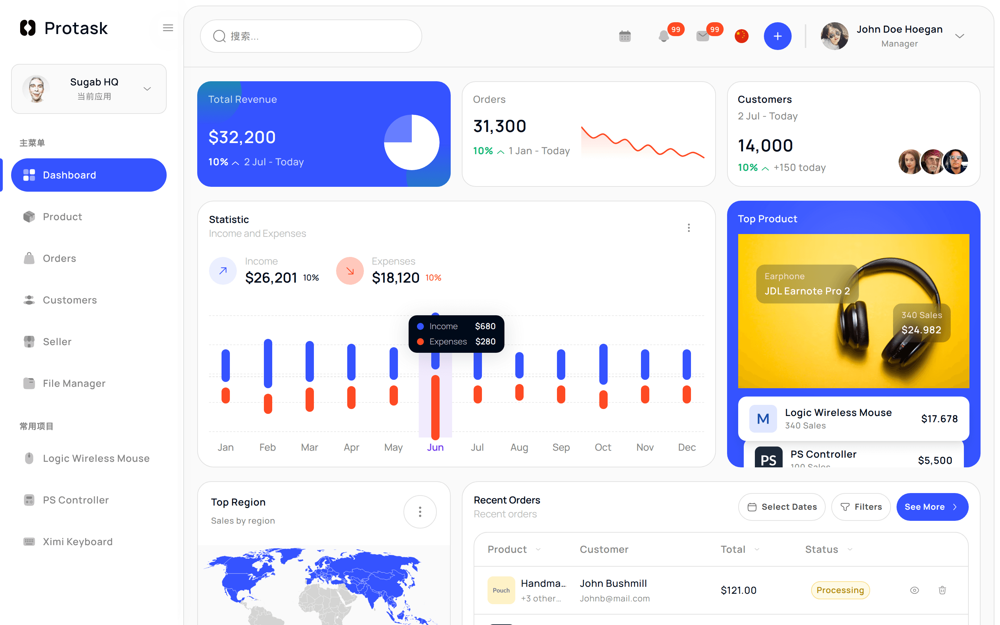
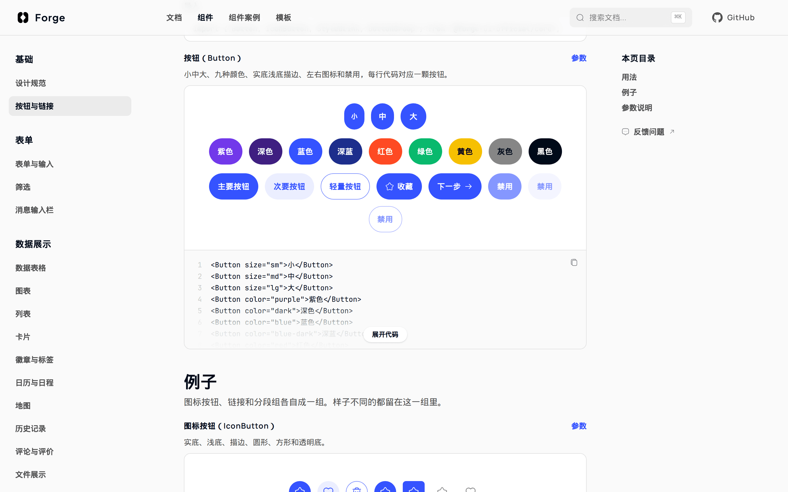
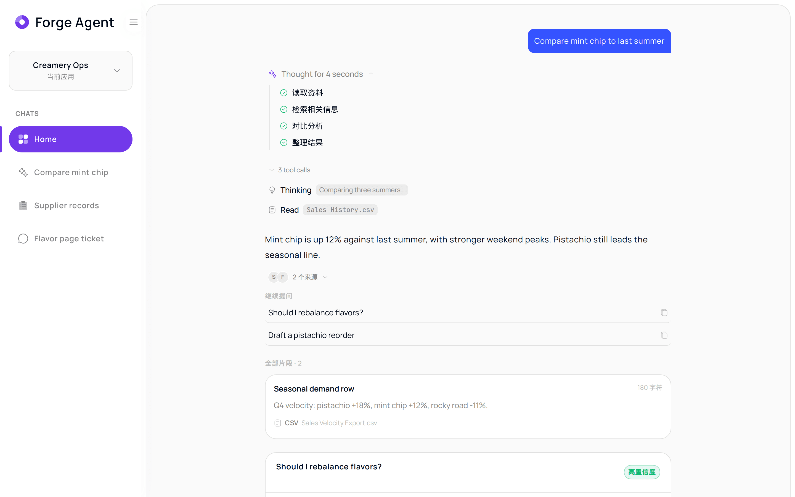
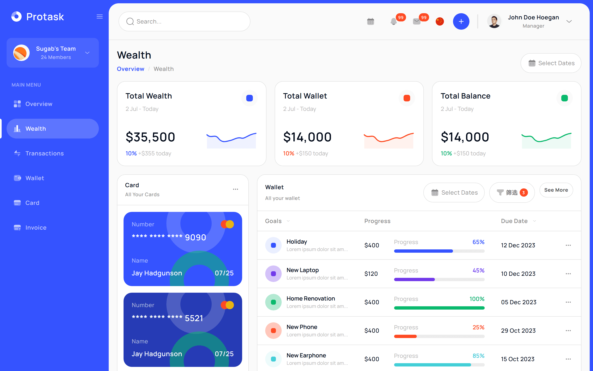

<p align="center">
  <picture>
    <source media="(prefers-color-scheme: dark)" srcset="./public/images/readme/logo-dark.svg">
    
  </picture>
</p>

<h1 align="center">Forge</h1>

<p align="center">面向企业后台和 SaaS 的 React 组件库与页面模板。</p>

<p align="center">
  <a href="https://www.npmjs.com/package/@forge-ui-official/core"></a>
  <a href="./LICENSE"></a>
</p>

<p align="center">
  <a href="https://forgeui.org">官网</a>
  ·
  <a href="https://forgeui.org/docs">文档</a>
  ·
  <a href="https://forgeui.org/components">组件</a>
  ·
  <a href="https://forgeui.org/templates">模板</a>
</p>

<p align="center">
  
</p>

### 仓库镜像

| 平台 | 仓库 |
| --- | --- |
| GitHub（权威） | https://github.com/forge-ui/forge |
| Gitee | https://gitee.com/forgeui/forge |
| AtomGit | https://atomgit.com/bitlink/forge |

官方开发与 Issue / Release 以 GitHub 为准；Gitee、AtomGit 为国内镜像。

人和 AI 按同一套组件规则做后台：设计 token、React 组件、`AppLayout`、业务模板，以及一份可安装的 Forge Skill。

## 为什么用 Forge

- **页面有现成结构。** 订单、商品、客户、项目、成员、文件、发票，以及列表、详情、新建和编辑，都有模板可以改。
- **视觉规范在组件里。** Button、Form、DataTable、Calendar、Chart、Card、Toolbar、Dialog、Tooltip、File、Avatar 等走 `@forge-ui-official/core`。颜色、字体、圆角、边框和密度不用每页重写。
- **后台壳已经装好。** `AppLayout` 带 sidebar、topbar、profile、notification、language switcher、team switcher 和 page header。
- **编码助手跟着同一套规则写。** Forge Skill 约束组件和 token，Forge Starter 负责快开，Forge Design Extension 在已经跑起来的页面上改界面。

## 快速开始

需要 React 19、Next.js 15 或以上、Tailwind v4，以及项目自行安装的 `@solar-icons/react` ^2.3.2。本仓库当前发布的组件包版本是 0.4.7。

### 新项目

从 [Forge Starter](https://github.com/forge-ui/forge-starter) 开始。里面有登录、后台壳和加模块的流程。

```bash
git clone https://github.com/forge-ui/forge-starter.git
cd forge-starter
pnpm install
pnpm dev
```

### 已有项目

```bash
pnpm add @forge-ui-official/core
pnpm add -D tailwindcss @tailwindcss/postcss
```

在入口 CSS 里引入样式。`@source` 只保留和文件位置匹配的那一行，否则 Tailwind v4 扫不到组件里的 class。

```css
@import "tailwindcss";
@import "@forge-ui-official/core/styles.css";

/* app/globals.css */
@source "../node_modules/@forge-ui-official/core/dist";

/* src/app/globals.css */
@source "../../node_modules/@forge-ui-official/core/dist";
```

```tsx
import { AppLayout, Button, DataTable, SurfaceCard } from "@forge-ui-official/core";
```

更细的安装说明见[文档站的快速开始](https://forgeui.org/docs/quick-start)。

## 生态

| | 做什么 | 从哪里开始 |
| --- | --- | --- |
| `@forge-ui-official/core` | 组件、设计 token、`AppLayout` | `pnpm add @forge-ui-official/core` |
| [Forge Starter](https://github.com/forge-ui/forge-starter) | 后台脚手架：登录、样板模块、加页面 | `git clone` 后 `pnpm dev` |
| [Forge Skill](https://forgeui.org/docs/ui-for-agents) | 让 Codex、Claude Code、Cursor 按组件和 token 写页面 | 下面的安装脚本 |
| [Forge Design Extension](https://github.com/forge-ui/forge-design-extension) | 在真实 Chrome 页面上点选、放置组件并改界面 | 独立仓库的 README |

Forge Design Extension 是 Chrome 插件加本机桥接。它不替代组件库，也不替代 Starter。Starter 负责把后台跑起来，Design Extension 负责改已经跑起来的页面：点中要改的位置，侧边栏里的本地模型带着真实 selector 改文案、样式和交互，或把 Forge 组件写入源码；也可以从组件盘拖到锚点旁，确认后再写入。页面内容留在本机，不经过云端。安装方式是启动本机桥接，在 Chrome 里加载 `extension/`。

相关示例：[forge-agent](https://github.com/forge-ui/forge-agent)，一个基于 Forge 的 AI Agent 产品壳。

## 组件与模板

<table>
  <tr>
    <td width="50%" align="center">
      <a href="https://forgeui.org/templates/ecommerce/products"></a><br>
      <a href="https://forgeui.org/templates/ecommerce/products">电商后台</a>
    </td>
    <td width="50%" align="center">
      <a href="https://forgeui.org/templates/dashboards/ecommerce-1"></a><br>
      <a href="https://forgeui.org/templates/dashboards/ecommerce-1">仪表盘</a>
    </td>
  </tr>
  <tr>
    <td width="50%" align="center">
      <a href="https://forgeui.org/components/button-link"></a><br>
      <a href="https://forgeui.org/components/button-link">组件</a>
    </td>
    <td width="50%" align="center">
      <a href="https://forgeui.org/templates/agent"></a><br>
      <a href="https://forgeui.org/templates/agent">智能体</a>
    </td>
  </tr>
  <tr>
    <td colspan="2" align="center">
      <a href="https://forgeui.org/templates/finance-template/wealth"></a><br>
      <a href="https://forgeui.org/templates/finance-template/wealth">暗色主题 · 财务后台</a>
    </td>
  </tr>
</table>

更多整页示例在[模板目录](https://forgeui.org/templates)：项目管理、客户关系、仪表盘外壳，以及 10 个已填数据的控制台。

## 给 AI 编码助手

写业务页之前，先读组件目录：

- [`docs/for-agents/README.md`](./docs/for-agents/README.md)：总入口
- [`docs/for-agents/routes.md`](./docs/for-agents/routes.md)：`/cases/*` 路由表
- [`docs/for-agents/components.md`](./docs/for-agents/components.md)：组件用途和对应 case

全量 export 清单在 [`docs/for-agents/inventory.json`](./docs/for-agents/inventory.json)。

安装 Forge Skill：

```bash
# Claude Code / Cursor
curl -fsSL https://forgeui.org/install-skill.sh | bash

# Codex
curl -fsSL https://forgeui.org/install-skill.sh | FORGE_AGENT=codex bash
```

官网域名暂时不可用时，从 GitHub 安装同一份脚本：

```bash
# Claude Code / Cursor
curl -fsSL https://raw.githubusercontent.com/forge-ui/forge/main/public/install-skill.sh | bash

# Codex
curl -fsSL https://raw.githubusercontent.com/forge-ui/forge/main/public/install-skill.sh | FORGE_AGENT=codex bash
```

<details>
<summary>新项目提示词，复制给 Codex</summary>

```text
请用 Forge 生态创建一个新的后台原型项目。

Forge 仓库地址：https://github.com/forge-ui/forge
Forge Starter 地址：https://github.com/forge-ui/forge-starter
Forge Design Extension 地址：https://github.com/forge-ui/forge-design-extension

请先确认本地已经安装或可读取 Forge Skill。
然后 clone Forge Starter 并初始化环境。
请确认项目已经安装 @forge-ui-official/core；如果 starter 没有带上，请执行 pnpm add @forge-ui-official/core。
同时确认入口 CSS 已引入 @forge-ui-official/core/styles.css，并且 Tailwind v4 已配置 @source 指向 @forge-ui-official/core/dist。
最后确认 pnpm dev、pnpm typecheck、pnpm build 都可用。

环境就绪后，先主动向我确认业务目标、用户角色、需要的页面/模块、核心数据对象、主要操作流程和验收标准。
我确认后，再开始设计并实现业务模块。

实现时请使用 Forge Skill；快开走 Forge Starter，在真实页面上改 UI 走 Forge Design Extension：
- Forge Skill 负责约束组件库、token、AppLayout 和基础样式。
- Forge Starter 负责后台壳、登录、业务样板和加模块流程。
- Forge Design Extension 负责在真实 Chrome 页面上点选、放置 Forge 组件并改界面。

页面实现优先使用 AppLayout 和 ForgeUI 组件，不要手写基础 Button/Card/Table/Form/Layout 样式。
页面布局可以按业务需要设计，但基础颜色、字体、圆角、边框、密度和响应式行为必须遵循 ForgeUI。

完成后运行 pnpm typecheck 和 pnpm build，并给出可访问地址、页面截图和剩余问题。
```

</details>

## 本地开发

仓库要求 Node.js `>=22.13.0`，包管理器由根目录 `packageManager` 固定为 pnpm 11.1.3。

```bash
pnpm install
pnpm dev
```

常用命令：

```bash
pnpm build           # 构建组件包和文档站
pnpm typecheck       # 检查组件包和站点类型
pnpm core:build      # 只构建 @forge-ui-official/core
pnpm core:typecheck  # 只检查组件包类型
pnpm lint            # ESLint
```

| 路径 | 说明 |
| --- | --- |
| `core/` | `@forge-ui-official/core` 源码 |
| `docs/for-agents/` | 给 AI 的组件路由表和介绍表，先读 `README.md` |
| `src/app/docs` | 文档页 |
| `src/app/components` | 组件展示和变体 |
| `src/app/cases` | 组件组合案例。props 以源码为准 |
| `src/app/templates` | 完整后台模板和业务页 |
| `skills/forge-react` | 可安装的 Forge Skill，给 Codex、Claude Code 和 Cursor 用 |
| `public/` | 图片、图标和安装脚本 |

## License

源码使用 [MIT License](./LICENSE)。图标使用 Solar Icons：React 实现为 MIT，480 Design 的图形为 CC BY 4.0。
