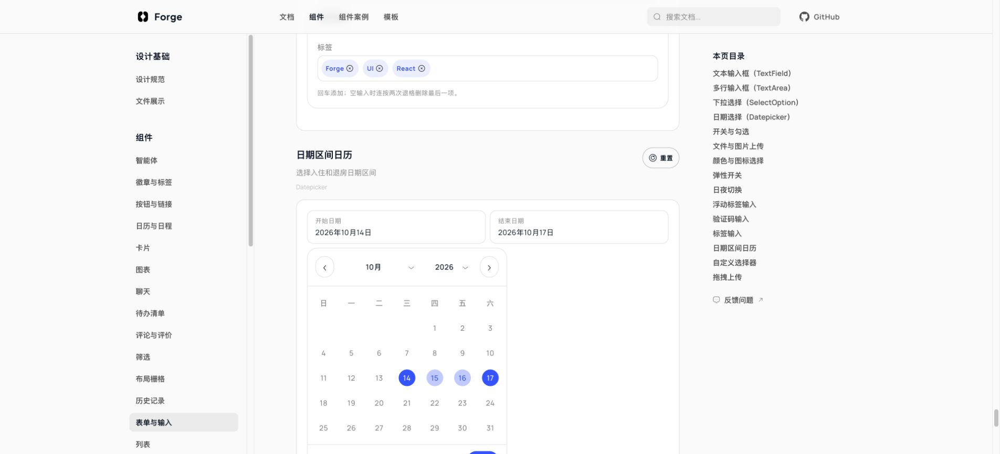
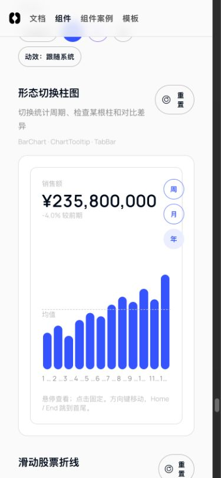

# 审计修复回归

在 `codex/component-fusion-migration` 本地修复全部18项已确认问题；未提交、推送、合并或发npm。

## 检查

- core:check：通过，271项组件测试、17项审计测试；新增7项回归测试。
- 官网交互测试：115项通过；包括99项双语三主题渲染及新增代码切换/删除撤销焦点测试。
- 官网 TypeScript：通过。
- core 构建与包契约检查：通过；新增可选参数的 API 快照已同步。
- 浏览器复核：日期区间、手机图表、参考线、删除/撤销焦点、阅读章节、代码切换、英文个人菜单、紫色成员面板、搜索展开。

## 逐项结果

| ID | 问题 | 修复与证据 |
|---|---|---|
| A1 | 章节导航重复扣除滚动容器偏移 | 章节 offsetTop 使用同一坐标系；滚到底部选中末节。Chrome：scrollTop=223，章节 offsetTop=223。 |
| A2 | 滑动删除接受右键和不匹配的pointerup | 只接受主按钮和主指针；up/cancel 校验 pointerId 并释放捕获。对抗事件回归通过。 |
| A3 | 键盘删除邮件后焦点掉回body | 删除后聚焦相邻邮件，撤销后聚焦恢复邮件。Chrome 与案例自动测试通过。 |
| A4 | 倾斜卡片光斑写死蓝色 | 光斑改用可覆盖主题变量，正式示例传入当前主题。 |
| FORM-01 | 内联日期点击起止标签会清空尚未应用的区间 | 内联端点按钮不重新初始化草稿。Chrome 保留14–17日、3晚，应用仍可用。 |
| FORM-02 | 受控日期外部更新不会同步确认草稿 | 按外部时间戳变化同步草稿；同值 Date 重建保留编辑。重置/应用回归通过。 |
| FORM-03 | 禁用焦点日期后没有键盘可进入的日期 | 不可选焦点日回退到当前月首个可选日，保持可用 tab stop。 |
| FORM-04 | 月末PageDown跳过整个月 | 翻月先定位目标月，再将日期截到月底，Jan31 → Feb28。 |
| FORM-05 | 禁用TextField仍允许删除标签 | disabled/state=disabled 均不提供标签移除操作。 |
| FORM-06 | 搜索展开动效在空容器初次挂载时就已播放 | 搜索动效仅由 data-open=true 触发；Chrome false=none、true=forge-fn-search-in。 |
| FORM-07 | 英语case仍暴露内置中文菜单和可访问名称 | 个人菜单、应用切换和导航文案透传语言；通知筛选名称本地化。英文侧栏 Chrome 实测通过。 |
| AC-01 | 少于六项的反应面板向上导航会产生负索引 | 双取模归一化，1/3/5个选项 ArrowUp 均保持合法焦点。 |
| AC-02 | 年度柱图固定柱宽撑破窄屏页面 | 柱列允许收缩，柱宽受槽位约束，标签保留等高空间。390px视口 document scrollWidth=clientWidth=375。 |
| AC-03 | 柱图参考线与柱形不共用数值坐标 | 参考线使用独立绘图区，从顶部按数值比例定位。168px绘图区误差小于0.01px。 |
| AC-04 | 变更审核中的代码/差异切换没有接入状态 | 案例接入 view/onViewChange。Chrome 与案例回归测试确认 Code 不显示新增差异行。 |
| AC-05 | 协作席位的添加成员面板没有跟随三主题 | AddMember 可选 accent，协作案例传主题；Chrome 紫色背景rgb(114,57,234)。 |
| AC-06 | 目标刻度的可视金额与朗读单位相差十倍 | 可访问名称统一为千元/K，与可见金额一致。 |
| AC-07 | 评价轮播带有未命名且无效的更多按钮 | 没有 onMenuClick 时不渲染按钮；提供操作时支持 menuLabel。 |

## 边界

- 既有 ask-ai-history 固定宽度审计警告仍在，非本轮18项问题，审计0错误。
- 046 Escape 自动化观察仍保留为未定位项；未将它计入本次已修复的18项，也未据此修改通用弹窗逻辑。
- 目录英文分类选择器的可访问占位名称一并本地化。

