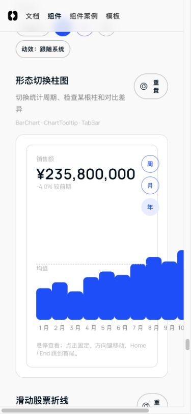

# 组件融合逐项审计

审计对象：`codex/component-fusion-migration` / `1795b1ba`。日期：2026-10-14。

三名子 agent 分组审计，覆盖全部 **99 项**（26 + 41 + 32），无重复或遗漏。确认 **18 项问题**：P2 15 项、P3 3 项。

本轮只读审计，未修改产品源码、提交、合并、推送或发布。报告包含旧组件缺陷与新融合问题，具体来源见分组证据。

## 验证边界

- 全部 99 项逐项核对正式实现、原型/对照、相关 core、双语/主题、状态与键盘路径；各项具体覆盖见下表及 JSON。
- 本轮独立完成 348 次 SSR 渲染（58 项 × 中英双语 × 三主题）、17 条状态流程、8 项现有表单测试，以及额外边界探针；其余 41 项未重跑全量 SSR。
- SSR、JSDOM 与源码审查不能替代全部设备的人工视觉验收；真实 Chrome 重点复核日期丢失、阅读跳转、图表溢出/坐标、主题、删除焦点。
- 046 命令菜单 Escape 在 Chrome 自动化中观察到未关闭；尚未确定事件投递或组件根因，单列待诊断，不计入已确认缺陷。
- 英文目录筛选框仍朗读“请选择...”，作为目录层本地化补充观察；与组件问题分别记录。
- 细节动效与原型的视觉差异、原生组件字体是否进一步调整保留为设计复核，不冒充功能缺陷。

## 已确认问题

### A1 · P2 · 章节导航重复扣除滚动容器偏移

涉及：058。位置：[actions-feedback.tsx:15](/Users/hesong/Documents/gihub_space/forge/src/app/components/_fusion/actions-feedback.tsx:15)。

- 触发：点击阅读卡片“精简/验证”或滚动切换当前章节
- 影响：章节跳转位置提前约132px，当前章节高亮提前切换
- 证据：root Chrome: article.offsetTop=132, section.offsetTop=223, clicked scrollTop=91; 标题距可视区域顶部132.49px。section.offsetTop已相对position:relative article。
- 建议：滚动及current判定使用section.offsetTop，同一坐标系并处理最后一节。

### A2 · P2 · 滑动删除接受右键和不匹配的pointerup

涉及：071。位置：[swipe-row.tsx:10](/Users/hesong/Documents/gihub_space/forge/core/src/internal/swipe-row.tsx:10)。

- 触发：右键按下并左拖超过100px；或pointer1拖动后pointer2抬起
- 影响：非主操作/其他手指能够调用不可逆业务onAction
- 证据：独立JSDOM /tmp/forge-audit-actions-swipe.mjs: RIGHT_DRAG_DELETE_COUNT 1; UNRELATED_POINTER_UP_DELETE_COUNT 2。原型071明确拒绝e.button!==0。
- 建议：down过滤主按钮/isPrimary，up和cancel匹配pointerId，释放capture。

### A3 · P2 · 键盘删除邮件后焦点掉回body

涉及：071。位置：[actions-feedback.tsx:31](/Users/hesong/Documents/gihub_space/forge/src/app/components/_fusion/actions-feedback.tsx:31)。

- 触发：Tab聚焦任一删除按钮并按Enter/Space
- 影响：按钮随行卸载，键盘用户失去列表位置；撤销也未恢复该行焦点
- 证据：/tmp/forge-audit-actions-flows.log: 071_AFTER_DELETE_ACTIVE_ELEMENT BODY；原型071会聚焦下一行及撤销后的首行。
- 建议：删除前记录邻项/按钮ref，删除后移至下项、上项或空态/撤销；undo聚焦恢复行。

### A4 · P3 · 倾斜卡片光斑写死蓝色

涉及：050。位置：[tokens.css:1231](/Users/hesong/Documents/gihub_space/forge/core/src/styles/tokens.css:1231)。

- 触发：050切换紫色或黑色并悬停卡片
- 影响：主体主题已切换，光斑仍为blue，不符合主题一致性
- 证据：forge-surface-card[data-effect="tilt"]:before radial-gradient直接使用--color-fg-blue；SurfaceCard无color/token override，case只设置--fusion-accent。静态确定，浏览器截图未采集。
- 建议：使用可覆盖的主题CSS变量并让case传当前主题。

### FORM-01 · P2 · 内联日期点击起止标签会清空尚未应用的区间

涉及：030。位置：[datepicker.tsx:254](/Users/hesong/Documents/gihub_space/forge/core/src/components/ui/forms/datepicker.tsx:254)。

来源：本轮新增能力。

- 触发：inline=true时日历已显示但open初值false；选择14–17后点击End，before=[StartOct14,EndOct17]，after=[StartSelect date,EndSelect date]且Apply disabled=true。
- 影响：rangeLabels handler用!open判定重开，未排除inline，setDraft覆盖未提交选择。
- 证据：inline=true时日历已显示但open初值false；选择14–17后点击End，before=[StartOct14,EndOct17]，after=[StartSelect date,EndSelect date]且Apply disabled=true。
- 建议：inline内切换端点不得重新初始化草稿；仅由真正关闭到打开时同步已提交值。

### FORM-02 · P2 · 受控日期外部更新不会同步确认草稿

涉及：030。位置：[datepicker.tsx:98](/Users/hesong/Documents/gihub_space/forge/core/src/components/ui/forms/datepicker.tsx:98)。

来源：本轮新增能力。

- 触发：rangeStart/end由2026-10-14/17改成11-10/12，inline confirmSelection仍显示10月并Apply回调旧值。
- 影响：draft仅useState初始化及toggleOpen同步，始终内联显示无同步路径。
- 证据：rangeStart/end由2026-10-14/17改成11-10/12，inline confirmSelection仍显示10月并Apply回调旧值。
- 建议：定义并实现外部值变化与正在编辑draft的同步/取消策略，覆盖异步加载和重置。

### FORM-03 · P2 · 禁用焦点日期后没有键盘可进入的日期

涉及：030。位置：[datepicker.tsx:390](/Users/hesong/Documents/gihub_space/forge/core/src/components/ui/forms/datepicker.tsx:390)。

来源：本轮新增能力。

- 触发：value=Oct1,minDate=Oct15,inline：31个day中enabledTabStops=0，唯一tabIndex0是disabled Oct1。
- 影响：roving tabIndex基于focusedDate或月初，未寻找当前月可用日期。
- 证据：value=Oct1,minDate=Oct15,inline：31个day中enabledTabStops=0，唯一tabIndex0是disabled Oct1。
- 建议：聚焦项先clamp到合法范围/首个可选日，月份导航后维持至少一个可用tab stop。

### FORM-04 · P2 · 月末PageDown跳过整个月

涉及：030。位置：[datepicker.tsx:164](/Users/hesong/Documents/gihub_space/forge/core/src/components/ui/forms/datepicker.tsx:164)。

来源：本轮新增能力。

- 触发：2026-01-31按PageDown得到Mar3,2026，无法按预期跳到Feb28。
- 影响：Date.setMonth保留31号产生溢出，PageUp也有同类问题。
- 证据：2026-01-31按PageDown得到Mar3,2026，无法按预期跳到Feb28。
- 建议：先设置目标年月，再将日clamp到该月最后一天。

### FORM-05 · P2 · 禁用TextField仍允许删除标签

涉及：029。位置：[text-field.tsx:107](/Users/hesong/Documents/gihub_space/forge/core/src/components/ui/forms/text-field.tsx:107)。

来源：既有组件问题，本次审计暴露。

- 触发：disabled=true且传onRemoveTag：input.disabled=true但点移除Forge会调用onRemoveTag一次。54598df8同样存在。
- 影响：onRemove传递未检查isDisabled；标签按钮保持可聚焦/可点击。
- 证据：disabled=true且传onRemoveTag：input.disabled=true但点移除Forge会调用onRemoveTag一次。54598df8同样存在。
- 建议：禁用状态不渲染可操作移除按钮或禁用按钮并阻止回调；覆盖state=disabled与disabled两入口。

### FORM-06 · P2 · 搜索展开动效在空容器初次挂载时就已播放

涉及：027。位置：[forms-navigation-menus.tsx:72](/Users/hesong/Documents/gihub_space/forge/src/app/components/_fusion/forms-navigation-menus.tsx:72)。

来源：本轮新增能力。

- 触发：forge-fn-search容器始终挂载，只有内部CommandSearch随open挂载；CSS33行animation无条件声明，data-open未参与任何动画选择器。点击展开只加入内容，无法重启动画。
- 影响：搜索展开动效在空容器初次挂载时就已播放
- 证据：forge-fn-search容器始终挂载，只有内部CommandSearch随open挂载；CSS33行animation无条件声明，data-open未参与任何动画选择器。点击展开只加入内容，无法重启动画。
- 建议：让动画随open进入/退出触发，或用保留退出的MotionPresence；覆盖第二次展开。

### FORM-07 · P2 · 英语case仍暴露内置中文菜单和可访问名称

涉及：040, 037, 074。位置：[sidebar-popovers.tsx:199](/Users/hesong/Documents/gihub_space/forge/core/src/components/layouts/sidebar-popovers.tsx:199)。

来源：既有组件问题，本次审计暴露。

- 触发：040切英语后ProfileDropdown硬编码编辑资料/修改密码/系统设置/退出登录，无locale可传；导航/折叠aria中文。037 menu aria-label应用切换固定；074未传ButtonGroup ariaLabel默认选项组。
- 影响：英语case仍暴露内置中文菜单和可访问名称
- 证据：040切英语后ProfileDropdown硬编码编辑资料/修改密码/系统设置/退出登录，无locale可传；导航/折叠aria中文。037 menu aria-label应用切换固定；074未传ButtonGroup ariaLabel默认选项组。
- 建议：将内置菜单与导航标签纳入本地化，并在正式case传入locale/可访问label。

### AC-01 · P2 · 少于六项的反应面板向上导航会产生负索引

涉及：077。位置：[chat-interactions.tsx:32](/Users/hesong/Documents/gihub_space/forge/core/src/internal/chat-interactions.tsx:32)。

- 触发：给ChatBubble提供5个reactionOptions，打开面板，首项按ArrowUp。
- 影响：cursor=-1，焦点留首项且全部按钮tabIndex=-1，roving focus失效。
- 证据：独立/tmp/forge-audit-c/run.mjs：before=0 after=0 tabs=[-1,-1,-1,-1,-1]。默认12项掩盖边界。
- 建议：使用双取模归一化或按实际行列夹取；增加1/3/5项键盘测试。

### AC-02 · P2 · 年度柱图固定柱宽撑破窄屏页面

涉及：095。位置：[bar-chart.tsx:95](/Users/hesong/Documents/gihub_space/forge/core/src/components/ui/charts/bar-chart.tsx:95)。

- 触发：390px视口打开095，切年。
- 影响：12根固定w-8柱加标签最小宽度大于绘图区，整页横向溢出，末月份超屏。
- 证据：root Chrome：document.scrollWidth458/client375；case.clientWidth311/scrollWidth426；10/11/12月右缘394/426/458；/tmp/forge-audit-chart-095.png。
- 建议：柱列min-w-0，并按可用槽位限制柱宽或明确局部横向滚动，避免页面溢出。

### AC-03 · P2 · 柱图参考线与柱形不共用数值坐标

涉及：095。位置：[bar-chart.tsx:63](/Users/hesong/Documents/gihub_space/forge/core/src/components/ui/charts/bar-chart.tsx:63)。

- 触发：095显示标签及均值参考线，比较参考线位置与柱形绘图区比例。
- 影响：参考值用含标签整高定位，border位于有文本高度span顶部；参考值位置不等于数据值对应y，误导均值比较。
- 证据：root Chrome年度：外容器192px、柱区168px、参考比例62.9808%、span高17px；实测lineTop=-2568.8047，按柱区应=-2560.6905，偏8.114px。无标签时仍有span高度偏移。
- 建议：将reference放入与柱相同绘图区，线用零高层定位、文字独立放置。

### AC-04 · P2 · 变更审核中的代码/差异切换没有接入状态

涉及：127。位置：[composition-editing.tsx:44](/Users/hesong/Documents/gihub_space/forge/src/app/components/_fusion/composition-editing.tsx:44)。

- 触发：打开127待审核状态，点击代码（Code）。
- 影响：可点击tab无反应，无法查看代码视图；示例传递错误的受控组件用法。
- 证据：/tmp/forge-audit-c/interaction.mjs：点击Code前后pre完全一样，同时显示return7删除行和return3新增行。
- 建议：用独立view state和onViewChange，或在固定diff展示时不显示不可用切换控件。

### AC-05 · P2 · 协作席位的添加成员面板没有跟随三主题

涉及：F05。位置：[tokens.css:1016](/Users/hesong/Documents/gihub_space/forge/core/src/styles/tokens.css:1016)。

- 触发：F05将主题由蓝切到紫或黑。
- 影响：席位切主题但添加成员面板持续青蓝，与本轮蓝/紫/黑约束及主题选择器不一致。
- 证据：root Chrome：--accent=#7239ea，.forge-member__shell background=rgb(105,216,223)，--forge-member-panel=#69d8df。既有AddMember默认CSS被新case直接带入。
- 建议：为AddMember公开/透传accent或在正式组合中明确接入theme变量；保持原生结构动效。

### AC-06 · P3 · 目标刻度的可视金额与朗读单位相差十倍

涉及：163。位置：[agent-charts-plots.tsx:81](/Users/hesong/Documents/gihub_space/forge/src/app/components/_fusion/agent-charts-plots.tsx:81)。

- 触发：163读滑杆无障碍名称，对比可见Target ¥70K。
- 影响：可见值单位千元，aria-label中英文写万元/10K，辅助技术给出错误金额尺度。
- 证据：源码和SSR：visible ¥74K / ¥70K，aria-label 季度目标（万元）/Quarterly target (10K)；原型$K一致。
- 建议：统一为千元/K，或者整体数值与可见单位都用万元。

### AC-07 · P3 · 评价轮播带有未命名且无效的更多按钮

涉及：057。位置：[composition-workflow.tsx:28](/Users/hesong/Documents/gihub_space/forge/src/app/components/_fusion/composition-workflow.tsx:28)。

- 触发：057评价卡右上更多按钮，鼠标点击或键盘聚焦。
- 影响：按钮无可访问名称且无handler；给用户和读屏提供无效操作。
- 证据：192次SSR仅057出现无名button；JSDOM读取React props确认onClick为undefined；源core review-item.tsx176–185总渲染该按钮。
- 建议：不传onMenuClick时隐藏原生菜单按钮，或case提供真正菜单和本地化名称。

## 99 项覆盖表

“未发现”仅表示此次检查范围未找到已确认缺陷，不等于所有环境验收通过。

| ID | 名称 | 正式页面 | 已确认问题 |
|---|---|---|---|
| 001 | 液态玻璃按钮 | [打开](http://localhost:3001/components/button-link#interaction-001) | 未发现 |
| 002 | 磁吸箭头按钮 | [打开](http://localhost:3001/components/button-link#interaction-002) | 未发现 |
| 003 | 长按删除 | [打开](http://localhost:3001/components/button-link#长按删除-button-hold#interaction-003) | 未发现 |
| 004 | 下载进度按钮 | [打开](http://localhost:3001/components/button-link#interaction-004) | 未发现 |
| 005 | 纸飞机发送 | [打开](http://localhost:3001/components/button-link#interaction-005) | 未发现 |
| 006 | 墨水涟漪按钮 | [打开](http://localhost:3001/components/button-link#interaction-006) | 未发现 |
| 007 | 播放暂停变形 | [打开](http://localhost:3001/components/button-link#interaction-007) | 未发现 |
| 008 | 复制完成反馈 | [打开](http://localhost:3001/components/button-link#interaction-008) | 未发现 |
| 009 | 文字滚动按钮 | [打开](http://localhost:3001/components/button-link#interaction-009) | 未发现 |
| 010 | 组合操作按钮 | [打开](http://localhost:3001/components/button-link#interaction-010) | 未发现 |
| 011 | 扇形快捷操作 | [打开](http://localhost:3001/components/menu#interaction-011) | 未发现 |
| 012 | 书签丝带 | [打开](http://localhost:3001/components/button-link#interaction-012) | 未发现 |
| 013 | 弹性开关 | [打开](http://localhost:3001/components/input-field#toggle#interaction-013) | 未发现 |
| 014 | 待办清单 | [打开](http://localhost:3001/components/checklist#interaction-014) | 未发现 |
| 015 | 套餐选择卡 | [打开](http://localhost:3001/components/card#interaction-015) | 未发现 |
| 016 | 星级评价 | [打开](http://localhost:3001/components/other-widget#interaction-016) | 未发现 |
| 018 | 滚动数量步进 | [打开](http://localhost:3001/components/input-field#interaction-018) | 未发现 |
| 019 | 兴趣多选 | [打开](http://localhost:3001/components/input-field#interaction-019) | 未发现 |
| 021 | 日夜切换 | [打开](http://localhost:3001/components/input-field#interaction-021) | 未发现 |
| 022 | 点赞心形绽放 | [打开](http://localhost:3001/components/button-link#interaction-022) | 未发现 |
| 023 | 通知设置展开 | [打开](http://localhost:3001/components/input-field#interaction-023) | 未发现 |
| 025 | 浮动标签输入 | [打开](http://localhost:3001/components/input-field#interaction-025) | 未发现 |
| 026 | 验证码输入 | [打开](http://localhost:3001/components/input-field#interaction-026) | 未发现 |
| 027 | 顶栏搜索展开 | [打开](http://localhost:3001/components/toolbar#interaction-027) | FORM-06 |
| 028 | 自动伸展评论框 | [打开](http://localhost:3001/components/comment#interaction-028) | 未发现 |
| 029 | 标签输入 | [打开](http://localhost:3001/components/input-field#interaction-029) | FORM-05 |
| 030 | 日期区间日历 | [打开](http://localhost:3001/components/calendar#interaction-030) | FORM-01, FORM-02, FORM-03, FORM-04 |
| 031 | 自定义选择器 | [打开](http://localhost:3001/components/input-field#selectoption#interaction-031) | 未发现 |
| 032 | 拖拽上传 | [打开](http://localhost:3001/components/input-field#interaction-032) | 未发现 |
| 033 | 标题内联编辑 | [打开](http://localhost:3001/components/input-field#interaction-033) | 未发现 |
| 036 | 密码强度 | [打开](http://localhost:3001/components/input-field#interaction-036) | 未发现 |
| 037 | 账号切换 | [打开](http://localhost:3001/components/menu#interaction-037) | FORM-07 |
| 039 | 滑动选中标签 | [打开](http://localhost:3001/components/tab#tabbar#interaction-039) | 未发现 |
| 040 | AppLayout 侧栏动效 | [打开](http://localhost:3001/prototype/sidebar-motion#interaction-040) | FORM-07 |
| 041 | 底部导航凹槽 | [打开](http://localhost:3001/components/menu#interaction-041) | 未发现 |
| 042 | 分步向导 | [打开](http://localhost:3001/components/pagination-stepper#interaction-042) | 未发现 |
| 043 | 分页伸缩 | [打开](http://localhost:3001/components/pagination-stepper#pagination#interaction-043) | 未发现 |
| 044 | 问答折叠 | [打开](http://localhost:3001/components/motion#accordion#interaction-044) | 未发现 |
| 045 | 菜单由按钮展开 | [打开](http://localhost:3001/components/menu#interaction-045) | 未发现 |
| 046 | 命令面板 | [打开](http://localhost:3001/components/agent#commandsearch#interaction-046) | 未发现 |
| 047 | 时间区间切换 | [打开](http://localhost:3001/components/tab#interaction-047) | 未发现 |
| 048 | 滑动联动标签 | [打开](http://localhost:3001/components/tab#interaction-048) | 未发现 |
| 049 | 层叠内容卡 | [打开](http://localhost:3001/components/card#interaction-049) | 未发现 |
| 050 | 光照倾斜卡 | [打开](http://localhost:3001/components/card#interaction-050) | A4 |
| 054 | 关注个人卡 | [打开](http://localhost:3001/components/card#interaction-054) | 未发现 |
| 056 | 月年计费切换 | [打开](http://localhost:3001/components/input-field#interaction-056) | 未发现 |
| 057 | 头像评价轮播 | [打开](http://localhost:3001/components/card#interaction-057) | AC-07 |
| 058 | 阅读进度卡 | [打开](http://localhost:3001/components/progress#interaction-058) | A1 |
| 059 | 活动报名卡 | [打开](http://localhost:3001/components/card#interaction-059) | 未发现 |
| 062 | 登录反馈 | [打开](http://localhost:3001/components/input-field#interaction-062) | 未发现 |
| 063 | 逐题注册 | [打开](http://localhost:3001/components/input-field#interaction-063) | 未发现 |
| 066 | 社交登录按钮 | [打开](http://localhost:3001/components/button-link#interaction-066) | 未发现 |
| 067 | 锁定倒计时 | [打开](http://localhost:3001/components/input-field#interaction-067) | 未发现 |
| 070 | 堆叠通知 | [打开](http://localhost:3001/components/modal#interaction-070) | 未发现 |
| 071 | 滑动删除与撤销 | [打开](http://localhost:3001/components/list#interaction-071) | A2, A3 |
| 074 | 通知铃菜单 | [打开](http://localhost:3001/components/menu#interaction-074) | FORM-07 |
| 075 | 上传进度面板 | [打开](http://localhost:3001/components/input-field#interaction-075) | 未发现 |
| 076 | 跟随工具提示 | [打开](http://localhost:3001/components/tooltip#interaction-076) | 未发现 |
| 077 | 表情反应面板 | [打开](http://localhost:3001/components/chat#interaction-077) | AC-01 |
| 078 | 滑动回复 | [打开](http://localhost:3001/components/chat#interaction-078) | 未发现 |
| 080 | 轨道同步指示 | [打开](http://localhost:3001/components/progress#interaction-080) | 未发现 |
| 081 | 环形完成反馈 | [打开](http://localhost:3001/components/progress#interaction-081) | 未发现 |
| 083 | 队列进度转换 | [打开](http://localhost:3001/components/progress#interaction-083) | 未发现 |
| 084 | 语音响应圆点 | [打开](http://localhost:3001/components/progress#interaction-084) | 未发现 |
| 086 | AI 流式回答 | [打开](http://localhost:3001/components/agent#interaction-086) | 未发现 |
| 087 | 配送步骤 | [打开](http://localhost:3001/components/progress#interaction-087) | 未发现 |
| 088 | 资料夹空态 | [打开](http://localhost:3001/components/list#列表空态与恢复#interaction-088) | 未发现 |
| 089 | 404 纠错 | [打开](http://localhost:3001/components/card#interaction-089) | 未发现 |
| 090 | 可重试错误卡 | [打开](http://localhost:3001/components/card#interaction-090) | 未发现 |
| 091 | 离线消息队列 | [打开](http://localhost:3001/components/chat#interaction-091) | 未发现 |
| 092 | 筛选空态恢复 | [打开](http://localhost:3001/components/filter#interaction-092) | 未发现 |
| 093 | 完成庆祝 | [打开](http://localhost:3001/components/modal#interaction-093) | 未发现 |
| 095 | 形态切换柱图 | [打开](http://localhost:3001/components/chart#interaction-095) | AC-02, AC-03 |
| 096 | 滑动股票折线 | [打开](http://localhost:3001/components/chart#interaction-096) | 未发现 |
| 097 | 重排环图 | [打开](http://localhost:3001/components/chart#interaction-097) | 未发现 |
| 098 | 实时数字滚动 | [打开](http://localhost:3001/components/card#statcard#interaction-098) | 未发现 |
| 099 | 活动环 | [打开](http://localhost:3001/components/chart#interaction-099) | 未发现 |
| 108 | 时区交集 | [打开](http://localhost:3001/components/calendar#interaction-108) | 未发现 |
| 110 | 日程冲突修复 | [打开](http://localhost:3001/components/calendar#interaction-110) | 未发现 |
| 126 | Markdown 编辑与预览 | [打开](http://localhost:3001/components/agent#interaction-126) | 未发现 |
| 127 | 变更片段审核 | [打开](http://localhost:3001/components/agent#interaction-127) | AC-04 |
| 128 | 查找替换 | [打开](http://localhost:3001/components/agent#interaction-128) | 未发现 |
| 129 | 代码折叠 | [打开](http://localhost:3001/components/agent#interaction-129) | 未发现 |
| 157 | 层叠用量面积 | [打开](http://localhost:3001/components/chart#interaction-157) | 未发现 |
| 163 | 目标刻度 | [打开](http://localhost:3001/components/chart#interaction-163) | AC-06 |
| 165 | 预测置信带 | [打开](http://localhost:3001/components/chart#interaction-165) | 未发现 |
| 176 | 版本胶片 | [打开](http://localhost:3001/components/history#interaction-176) | 未发现 |
| 177 | 撤销重做历史 | [打开](http://localhost:3001/components/history#interaction-177) | 未发现 |
| 178 | 批量选择操作台 | [打开](http://localhost:3001/components/list#选择与批量操作#interaction-178) | 未发现 |
| 179 | 文字片段拼接 | [打开](http://localhost:3001/components/other-widget#interaction-179) | 未发现 |
| 180 | 审批签署 | [打开](http://localhost:3001/components/agent#interaction-180) | 未发现 |
| 181 | 工作分派 | [打开](http://localhost:3001/components/agent#interaction-181) | 未发现 |
| 184 | 角色权限矩阵 | [打开](http://localhost:3001/components/table#interaction-184) | 未发现 |
| F01 | 附件队列 | [打开](http://localhost:3001/components/chat#interaction-F01) | 未发现 |
| F02 | 工具运行卡 | [打开](http://localhost:3001/components/agent#interaction-F02) | 未发现 |
| F03 | 列表批量操作 | [打开](http://localhost:3001/components/list#选择与批量操作#interaction-F03) | 未发现 |
| F04 | 生成内容审核 | [打开](http://localhost:3001/components/agent#interaction-F04) | 未发现 |
| F05 | 协作席位 | [打开](http://localhost:3001/components/agent#interaction-F05) | AC-05 |
| F06 | 搜索无结果恢复 | [打开](http://localhost:3001/components/filter#interaction-F06) | 未发现 |

## 证据

- [完整覆盖与问题 JSON](coverage.json)
- [动作与反馈](evidence/forge-audit-actions.md)
- [表单与导航](evidence/forge-audit-forms.md)
- [智能体、图表与组合](evidence/forge-audit-agent-compositions.md)

窄屏年度柱图实测：

